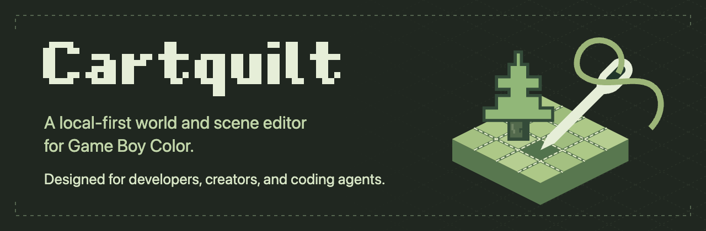

# 

[](https://github.com/cliffom/cartquilt/actions/workflows/pr-checks.yml)

Cartquilt is a local-first Game Boy Color world and scene editor designed for developers, creators, and coding agents. Arrange scenes on a world map, open one to move an actor, and see the change in its map thumbnail. The editor runs in your browser, with a Go service on your computer that reads the project and its artwork.

## Get started

Install Go 1.25 or later and Node.js 20 or later with npm. From the repository root, run:

```sh
npm ci
npm start
```

Open [Cartquilt on your computer](http://127.0.0.1:4173) and choose **New project** or **Open project**. Keep the terminal open while editing. Press Ctrl+C there to stop the service.

**Edits last for the current tab.** You can move between scenes and keep your drafts, map layout, and undo history. Closing or reloading the tab discards them. Cartquilt asks the browser to warn you if you’ve edited a scene or moved a scene card.

## Try your first edit

Choose **Open project** and select the included `examples/threadvale` folder to try the two-scene sample.

1. Drag **Willow Bank** to a new spot on the map, then double-click its card or select **Open scene** in the Inspector.
2. Select the **Courier** on the canvas or in the Navigator. In the Inspector, change **X** from **73** to **81**. The Courier moves one tile to the right.
3. Choose **← World map**. Willow Bank is where you placed it, and its thumbnail shows the Courier’s new position. **Draft** marks the scene you edited.
4. Visit **Loom Yard**, then reopen Willow Bank. Choose **Undo** to move the Courier back and clear the draft. **Redo** restores the move.

**Map controls.** Drag the background to pan, scroll to zoom around the pointer, or choose **Fit** to bring all scenes into view. With the map focused, use the arrow keys to pan and + or − to zoom. Tab to a card, then press Enter to open it or Shift+arrow to move it. On narrow screens, the **Navigator** and **Inspector** buttons sit beneath the toolbar.

## Open your own project

Choose **New project** in the launcher or the editor’s **Project** menu. Enter a name. On macOS, click **Browse** to select an existing parent folder in the system dialog. Cartquilt suggests the full path using your project name. You can edit the path or enter it directly. Choose **Create project** to write `project.json` and open the empty world in the current tab. If the current tab has unsaved edits, Cartquilt offers a new-tab link to keep your draft open. To start with scenes and artwork, copy the [Threadvale example folder](examples/threadvale/) instead.

After a restart, choose a project in **Recent projects** to reopen it in the same browser on the same port. You can also choose **Open project** and select its folder or enter the path to its saved JSON file. Give the plugin the same path to load the same project. The editor's readable project URL is assigned for the current server session.

You can also start the service with a specific saved file:

```sh
npm run build
go run ./cmd/cartquilt -project path/to/project.json
```

Keep referenced PNGs beside `project.json`. Scene dimensions are in 8-pixel tiles. Actor positions and sizes are in pixels, measured from the scene’s top-left corner. You can also [create a project from Codex](docs/codex-plugin.md#create-a-project).

## Development and roadmap

From the repository root, run `npm run format` to apply gofmt to Go code and Biome to TypeScript and JavaScript source, tests, and tooling. Use `npm run format:check` for a read-only formatting check.

Run `npm run lint` for Go vet, Biome’s recommended lint rules, and strict TypeScript checking. Before handing off a change, run `npm run check` to verify formatting, lint, and tests together.

Run `npm test` to build the TypeScript client and check the Go service, the project data exchanged with the browser, and scene undo/redo. The [engineering guide](AGENTS.md) describes how the service, scene documents, and workspace share responsibility.

Saving edits to disk, building playable output, and authoring through a revision-aware Codex plugin are planned. Follow the [milestone roadmap](ROADMAP.md), [plugin delivery plan](docs/codex-plugin.md), and [decision log](docs/decisions/README.md) for the next deliverables and how to verify them.
